# Super Dolores

**Alumno:** Omar Mendez

## Evidencias de pruebas TDD

### Ronda 2: Dinero y fechas

**ROJO**

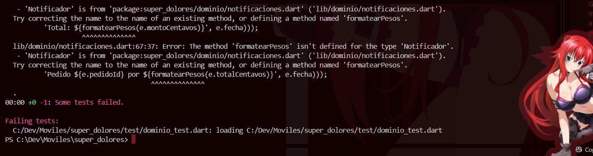

**VERDE**

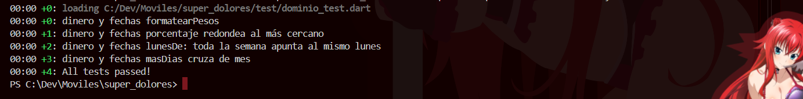

### Ronda 3: Monedero

**ROJO**

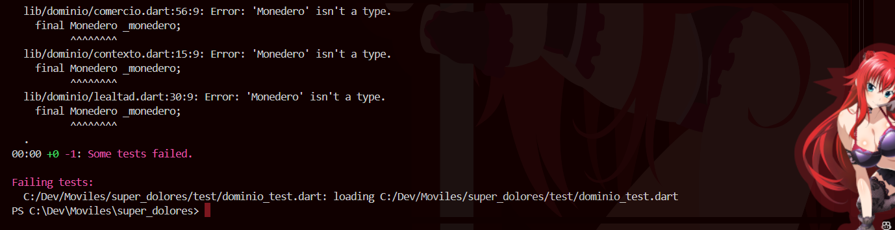

**VERDE**

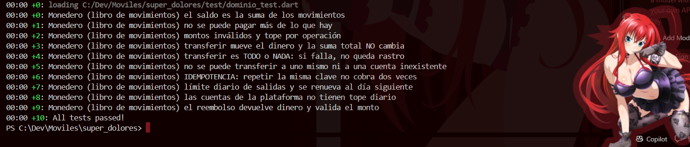

### Ronda 4: Bus de eventos

**ROJO**

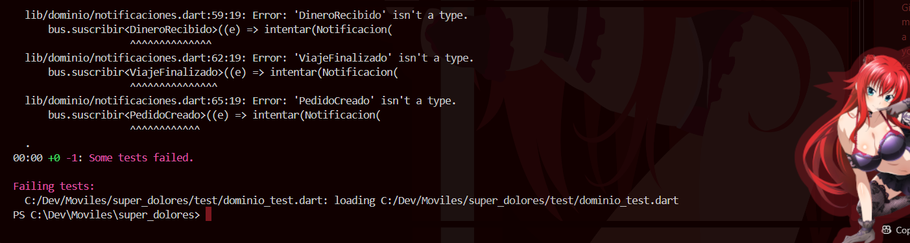

**VERDE**

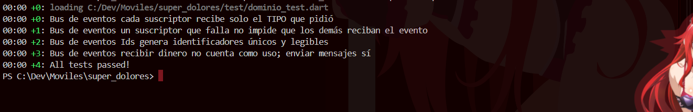

### Ronda 5: Mensajería

**ROJO**

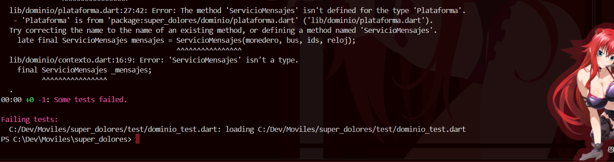

**VERDE**

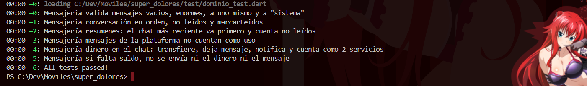

### Ronda 6: Comercio

**ROJO**

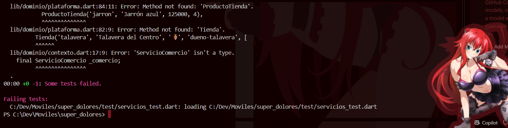

**VERDE**

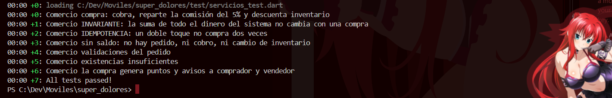

### Ronda 7: Transporte

**ROJO**

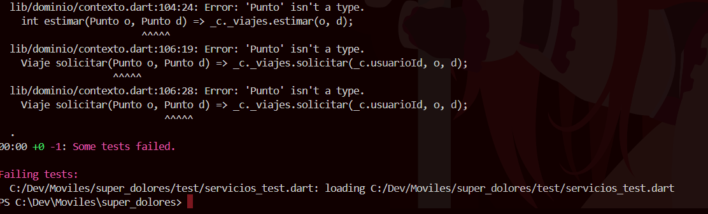

**VERDE**

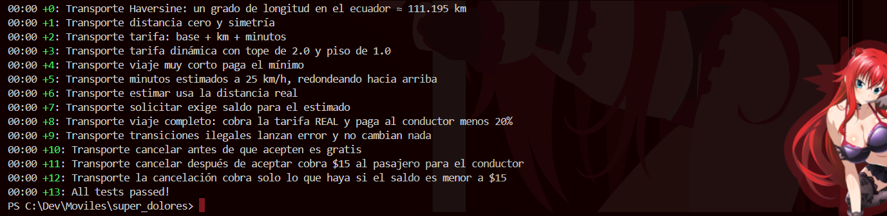

### Ronda 8: Mini-apps

**ROJO**

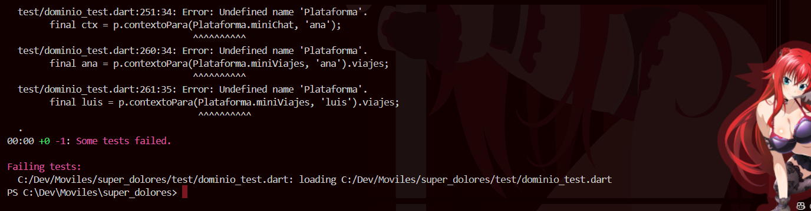

**VERDE**

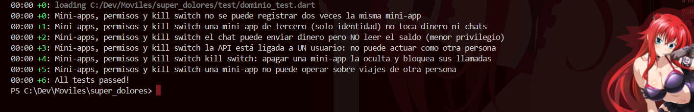

### Ronda 9: Lealtad

**ROJO**

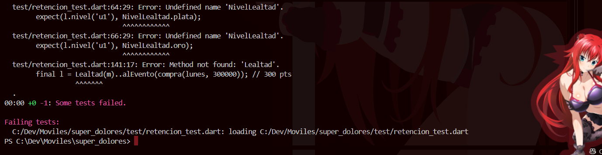

**VERDE**

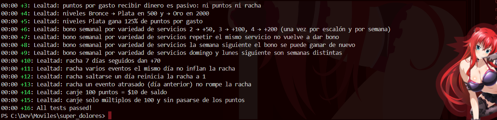

### Ronda 10: Analítica

**ROJO**

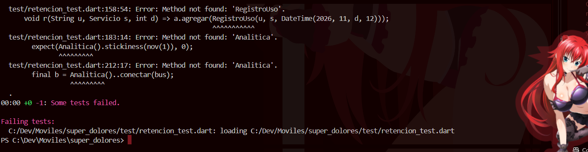

**VERDE**

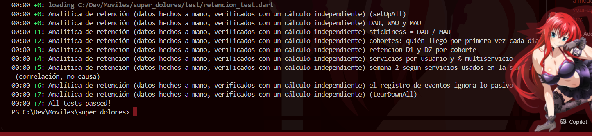

### Ronda 11: Notificaciones y sugerencias

**ROJO**

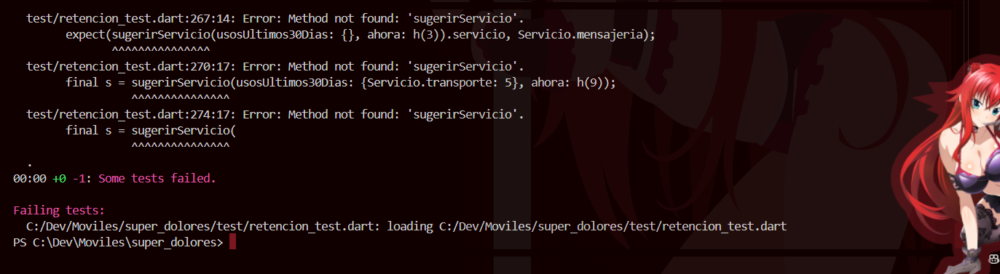

**VERDE**

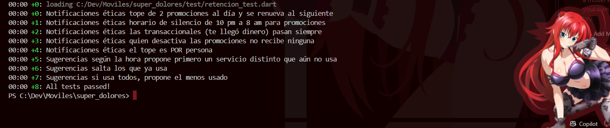

### Ronda 12: ViewModels

**ROJO**

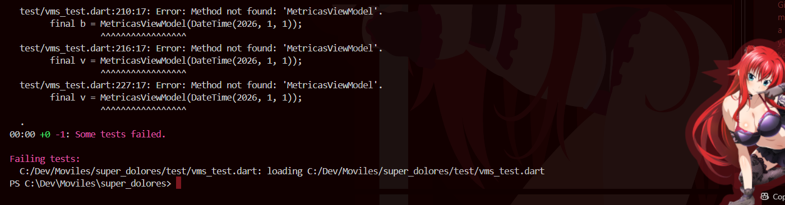

**VERDE**

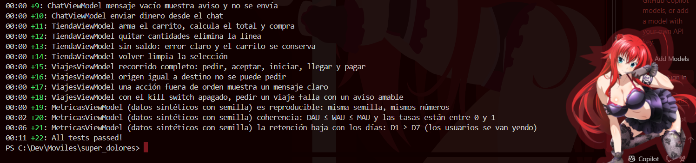

## Ejecución final de pruebas

**Resultado: 104 tests aprobados.**

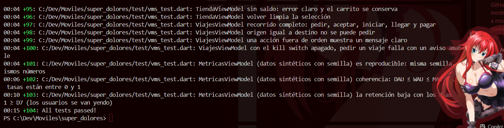

## Interfaz de la aplicación

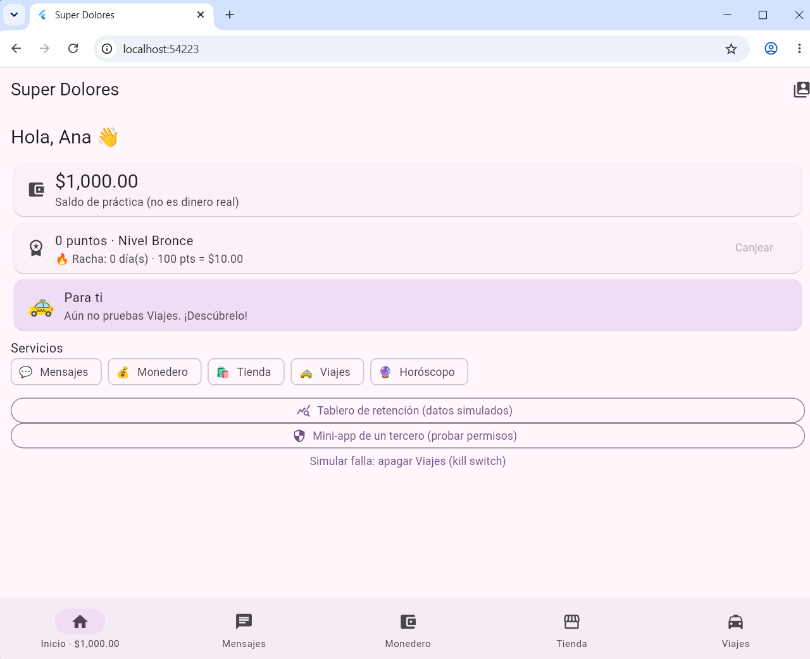

## Aclaraciones sobre las rondas

Las rondas 1, 13, 14 y 15 no tienen pruebas.

- **Ronda 1:** corresponde a la preparación del proyecto.
- **Ronda 13:** corresponde a las pantallas de la aplicación. De esta ronda se obtiene la imagen de la interfaz utilizada en este README.
- **Rondas 14 y 15:** corresponden a contenido textual, por lo que no requieren pruebas.